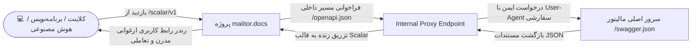

<div align="center">

# ⚡ Malitor Interactive API Documentation
### وب‌سرویس جامع، پروکسی هوشمند OpenAPI و موتور اتصال ابری به سامانه مودیان مالیاتی

[](https://dotnet.microsoft.com/)
[](https://scalar.com/)
[](https://swagger.io/specification/)
[](LICENSE)
[](https://github.com/your-username/malitor.docs/stargazers)

<br/>

<p align="center">
  <b>مالیتور (Malitor)</b> پیچیده‌ترین لایه‌های اتصال به کارپوشه سازمان امور مالیاتی—از جمله امضای دیجیتال نامتقارن، ساخت توکن‌های کلید عمومی/خصوصی، رمزنگاری کدهای مالیاتی ۲۲ رقمی و صف‌های ناهمگام را انتزاع کرده و در قالب یک <b>REST API سریع، پایدار و آماده برای ایجنت‌های هوش مصنوعی (AI Agents)</b> ارائه می‌دهد.
</p>

<p align="center">
  <a href="#-معماری-پروژه-malitordocs">معماری پروژه</a> •
  <a href="#-راه‌اندازی-سریع-در-visual-studio">راه‌اندازی سریع</a> •
  <a href="#-اندپوینت‌های-کلیدی-سامانه-مودیان">اندپوینت‌ها</a> •
  <a href="#-نمونه-کدهای-عملیاتی">نمونه کدها</a> •
  <a href="#-اتصال-ایجنت‌های-هوش-مصنوعی-ai-agents--tool-calling">هوش مصنوعی و Tool Calling</a> •
  <a href="#-راهنمای-اتصال-اکسل-vba">اتصال اکسل</a>
</p>

</div>

---

## 🧭 فهرست مطالب

1. [معماری پروژه `malitor.docs`](#-معماری-پروژه-malitordocs)
2. [راه‌اندازی سریع در Visual Studio](#-راه‌اندازی-سریع-در-visual-studio)
3. [امنیت و احراز هویت](#-امنیت-و-احراز-هویت-authentication)
4. [اندپوینت‌های کلیدی سامانه مودیان](#-اندپوینت‌های-کلیدی-سامانه-مودیان)
5. [جدول مدل‌ها و داده‌های مجاز (Schemas)](#-جدول-مدل‌ها-و-داده‌های-مجاز-schemas)
6. [نمونه کدهای عملیاتی (C#, PHP, Python, cURL)](#-نمونه-کدهای-عملیاتی)
7. [راهنمای اتصال اکسل (VBA)](#-راهنمای-اتصال-اکسل-vba)
8. [اتصال ایجنت‌های هوش مصنوعی (AI Agents & Tool Calling)](#-اتصال-ایجنت‌های-هوش-مصنوعی-ai-agents--tool-calling)
9. [کدهای خطا و عیب‌یابی (Troubleshooting)](#-کدهای-خطا-و-عیب‌یابی-troubleshooting)

---

## 🏛 معماری پروژه `malitor.docs`

این ریپازیتوری یک سرویس سبک مبتنی بر **ASP.NET Core Minimal APIs** است که نقش **Secure Spec Proxy** و **Interactive API Portal** را بر بستر پلتفرم فوق‌سریع **Scalar** ایفا می‌کند:



### مزایای کلیدی این معماری:
* **دور زدن محدودیت‌های فایروال و CORS:** با داشتن کلاینت داخلی `HttpClient` همراه با `User-Agent` استاندارد مرورگر، هیچ‌گونه تداخل امنیتی با CDN یا فایروال‌ها ایجاد نمی‌شود.
* **رابط کاربری جذاب (Scalar Purple Theme):** سرعتی به مراتب بالاتر از Swagger UI کلاسیک، جستجوی بلادرنگ، رندر آفلاین مدل‌ها و امکان ساخت تست‌های درجا در مرورگر.
* **ریدایرکت خودکار به مستندات:** دسترسی به ریشه برنامه (`/`) مستقیماً کاربر را به محیط تعاملی داکیومنت هدایت می‌کند.

---

## 🚀 راه‌اندازی سریع در Visual Studio

### پیش‌نیازها
* [.NET 8.0 SDK](https://dotnet.microsoft.com/download/dotnet/8.0) یا جدیدتر
* Visual Studio 2022 (نسخه 17.8 به بالا) با قابلیت *ASP.NET and web development*

### مراحل اجرا
۱. ریپازیتوری را کلون فرمایید:
```bash
git clone https://github.com/your-username/malitor.docs.git
cd malitor.docs
```

۲. فایل راهکار (`malitor.docs.sln`) را در Visual Studio باز کنید.

۳. پکیج‌های NuGet را بازگردانی (Restore) کنید:
```bash
dotnet restore
```

۴. با فشردن کلید **`F5`** یا **`Ctrl + F5`** پروژه را اجرا کنید. مرورگر به صورت پیش‌فرض باز شده و مستندات Scalar در آدرس زیر نمایان می‌شود:
```text
https://localhost:port/scalar/v1
```

---

## 🔐 امنیت و احراز هویت (Authentication)

تمام اندپوینت‌های وب‌سرویس عملیاتی از طریق کلید تبادل امن محافظت می‌شوند.

```http
X-API-KEY: [کلید ۳۲ کاراکتری اختصاصی مودی]
Content-Type: application/json
Accept: application/json
```

* **آدرس سرور پایه (Production Base URL):**  
  `https://apiaddress.ir/api/v1`

> ⚠️ **نکته امنیتی:** کلید تبادل شما دسترسی مستقیم به سهمیه و کارپوشه مالیاتی‌تان دارد. آن را در مخازن عمومی گیت قرار ندهید و برای کلاینت‌های سروری از متغیرهای محیطی (`Environment Variables`) استفاده کنید.

---

## 📡 اندپوینت‌های کلیدی سامانه مودیان

| متد | مسیر (Route) | هدف عملیاتی |
| :---: | :--- | :--- |
| `GET` | `/Invoices/quota` | مشاهده سقف ارسال روزانه و باقیمانده شارژ کیف پول مودی |
| `POST` | `/Invoices/pattern1` | ثبت و ارسال صورتحساب الکترونیکی الگوی ۱ (فروش کالا و خدمات) |
| `GET` | `/Invoices/inquiry/{trackingCode}` | استعلام لحظه‌ای کارپوشه، دریافت کد ۲۲ رقمی مالیاتی (`taxId`) و خطاها |
| `GET` | `/Invoices` | دریافت تاریخچه صورتحساب‌ها با کنترل صفحه‌بندی (`pageNumber` و `pageSize`) |
| `GET` | `/Invoices/details/{trackingUid}` | دریافت کامل مشخصات هدر، ردیف‌های اقلام و وضعیت پرداختی یک فاکتور |

---

## 📊 جدول مدل‌ها و داده‌های مجاز (Schemas)

### ۱. موضوع صورتحساب (`InvoiceSubject`)
| کد | موضوع | فیلد شناسه مرجع (`referenceTaxId`) |
| :---: | :---: | :---: |
| `1` | صورتحساب اصلی | غیرضروری (`null`) |
| `2` | صورتحساب اصلاحی | **الزامی** (کد ۲۲ رقمی فاکتور قبلی) |
| `3` | صورتحساب ابطالی | **الزامی** (کد ۲۲ رقمی فاکتور قبلی) |
| `4` | برگشت از فروش | **الزامی** (کد ۲۲ رقمی فاکتور قبلی) |

### ۲. نوع خریدار (`BuyerType`)
| کد | عنوان خریدار | شناسه هویتی الزامی |
| :---: | :--- | :--- |
| `1` | شخص حقیقی | کد ملی ۱۰ رقمی (`buyerNationalCode`) |
| `2` | شخص حقوقی | شناسه ملی ۱۱ رقمی (`buyerNationalFin`) |
| `3` | مشارکت مدنی | شناسه مشارکت |
| `4` | اتباع غیرایرانی | شناسه فراگیر |
| `5` | مصرف‌کننده نهایی | بدون نیاز به شناسه |

### ۳. روش تسویه حساب (`SettlementType`)
| کد | روش | الزامات فیلدهای مبلغی |
| :---: | :--- | :--- |
| `1` | نقدی | مقداردهی به `cashPayment` |
| `2` | نسیه | مقداردهی به `creditPayment` |
| `3` | نقدی و نسیه | مقداردهی هم‌زمان به هر دو فیلد |

---

## 💻 نمونه کدهای عملیاتی

<details>
<summary><b>🔹 C# (.NET 8+ / RestSharp)</b></summary>

```csharp
using System;
using RestSharp;

var client = new RestClient("https://apiaddress.ir/api/v1/Invoices/pattern1");
var request = new RestRequest("", Method.Post);

request.AddHeader("X-API-KEY", "YOUR_32_CHAR_API_KEY");
request.AddHeader("Content-Type", "application/json");

var invoiceBody = new
{
    internalNo = 1050,
    invoiceDateTime = DateTime.Now.ToString("s"),
    invoiceType = 1,
    invoiceSubject = 1,
    referenceTaxId = (string?)null,
    isArticle9 = false,
    buyerType = 1,
    buyerName = "رضا محمدی",
    buyerNationalCode = "0012345678",
    invoicePattern = 1,
    settlementType = 1,
    cashPayment = 1100000m,
    creditPayment = 0m,
    items = new[]
    {
        new
        {
            sstid = "2720000114427",
            sstt = "خدمات پشتیبانی نرم‌افزار",
            am = 1.0m,
            fee = 1000000m,
            dis = 0m,
            vra = 10.0m,
            unit = "162"
        }
    }
};

request.AddJsonBody(invoiceBody);
var response = await client.ExecuteAsync(request);

Console.WriteLine($"Status: {response.StatusCode}");
Console.WriteLine($"Response: {response.Content}");
```
</details>

<details>
<summary><b>🔹 Python (Requests)</b></summary>

```python
import requests
from datetime import datetime

url = "https://apiaddress.ir/api/v1/Invoices/pattern1"
headers = {
    "X-API-KEY": "YOUR_32_CHAR_API_KEY",
    "Content-Type": "application/json"
}

payload = {
    "internalNo": 1052,
    "invoiceDateTime": datetime.now().strftime("%Y-%m-%dT%H:%M:%S"),
    "invoiceType": 1,
    "invoiceSubject": 1,
    "referenceTaxId": None,
    "isArticle9": False,
    "buyerType": 1,
    "buyerName": "شرکت داده‌پرداز نمونه",
    "buyerNationalCode": "0012345678",
    "invoicePattern": 1,
    "settlementType": 1,
    "cashPayment": 1100000.0,
    "creditPayment": 0.0,
    "items": [
        {
            "sstid": "2720000114427",
            "sstt": "پشتیبانی سالانه سامانه ابری",
            "am": 1.0,
            "fee": 1000000.0,
            "dis": 0.0,
            "vra": 10.0,
            "unit": "162"
        }
    ]
}

response = requests.post(url, headers=headers, json=payload)
print(f"Status Code: {response.status_code}")
print(response.json())
```
</details>

<details>
<summary><b>🔹 PHP (cURL)</b></summary>

```php
<?php
$apiKey = "YOUR_32_CHAR_API_KEY";
$url = "https://apiaddress.ir/api/v1/Invoices/pattern1";

$payload = [
    "internalNo" => 1053,
    "invoiceDateTime" => date('Y-m-d\TH:i:s'),
    "invoiceType" => 1,
    "invoiceSubject" => 1,
    "buyerType" => 1,
    "buyerName" => "خریدار فروشگاه آنلاین",
    "buyerNationalCode" => "0012345678",
    "invoicePattern" => 1,
    "settlementType" => 1,
    "cashPayment" => 1100000.0,
    "items" => [
        [
            "sstid" => "2720000114427",
            "sstt" => "تحویل آنی لایسنس نرم‌افزار",
            "am" => 1,
            "fee" => 1000000,
            "dis" => 0,
            "vra" => 10,
            "unit" => "162"
        ]
    ]
];

$ch = curl_init($url);
curl_setopt($ch, CURLOPT_RETURNTRANSFER, true);
curl_setopt($ch, CURLOPT_POST, true);
curl_setopt($ch, CURLOPT_POSTFIELDS, json_encode($payload));
curl_setopt($ch, CURLOPT_HTTPHEADER, [
    "X-API-KEY: " . $apiKey,
    "Content-Type: application/json"
]);

$response = curl_exec($ch);
curl_close($ch);

echo $response;
?>
```
</details>

<details>
<summary><b>🔹 cURL (Terminal / Bash)</b></summary>

```bash
curl -X POST "https://apiaddress.ir/api/v1/Invoices/pattern1" \
     -H "Accept: application/json" \
     -H "Content-Type: application/json" \
     -H "X-API-KEY: YOUR_32_CHAR_API_KEY" \
     -d '{
       "internalNo": 1054,
       "invoiceDateTime": "2026-11-06T10:30:00",
       "invoiceType": 1,
       "invoiceSubject": 1,
       "buyerType": 1,
       "buyerName": "رضا محمدی",
       "buyerNationalCode": "0012345678",
       "invoicePattern": 1,
       "settlementType": 1,
       "cashPayment": 1100000.0,
       "items": [
         {
           "sstid": "2720000114427",
           "sstt": "مشاوره راهکارهای ابری",
           "am": 1.0,
           "fee": 1000000.0,
           "dis": 0.0,
           "vra": 10.0,
           "unit": "162"
         }
       ]
     }'
```
</details>

---

## 📗 راهنمای اتصال اکسل (VBA)

تیم‌های مالی بدون نیاز به تغییر سیستم یا خرید نرم‌افزارهای جانبی می‌توانند مستقیماً از شیت‌های اکسل به مالیتور متصل شوند:

۱. در اکسل کلیدهای ترکیبی `Alt + F11` را بزنید تا پنجره **VBA Editor** باز شود.  
۲. از منو، گزینه **Insert > Module** را انتخاب فرمایید.  
۳. کد زیر را کپی کرده و ماکرو را به یک دکمه (Button) در شیت فاکتور متصل کنید:

```vb
Sub SendInvoiceToMalitor()
    Dim http As Object
    Dim url As String, apiKey As String, jsonPayload As String, responseText As String
    
    url = "https://apiaddress.ir/api/v1/Invoices/pattern1"
    apiKey = "YOUR_32_CHAR_API_KEY"
    
    ' ساخت بدنه فاکتور (می‌توانید مقادیر را از Range("A2").Value بخوانید)
    jsonPayload = "{" & _
        """internalNo"": 1060," & _
        """invoiceDateTime"": """ & Format(Now, "yyyy-mm-ddThh:mm:ss") & """," & _
        """invoiceType"": 1," & _
        """invoiceSubject"": 1," & _
        """isArticle9"": false," & _
        """buyerType"": 1," & _
        """buyerName"": ""خریدار از اکسل""," & _
        """buyerNationalCode"": ""0012345678""," & _
        """invoicePattern"": 1," & _
        """settlementType"": 1," & _
        """cashPayment"": 1100000," & _
        """items"": [{" & _
            """sstid"": ""2720000114427""," & _
            """sstt"": ""فروش کالا از طریق شیت اکسل""," & _
            """am"": 1," & _
            """fee"": 1000000," & _
            """dis"": 0," & _
            """vra"": 10," & _
            """unit"": ""162""" & _
        "}]" & _
    "}"
    
    Set http = CreateObject("MSXML2.ServerXMLHTTP.6.0")
    http.Open "POST", url, False
    http.setRequestHeader "Content-Type", "application/json"
    http.setRequestHeader "X-API-KEY", apiKey
    
    On Error GoTo ErrorHandler
    http.send jsonPayload
    
    responseText = http.responseText
    MsgBox "نتیجه ارسال به سامانه مودیان: " & vbCrLf & responseText, vbInformation, "مالیتور"
    Exit Sub

ErrorHandler:
    MsgBox "خطا در ارتباط با سرور مالیتور: " & Err.Description, vbCritical, "خطا"
End Sub
```

---

## 🤖 اتصال ایجنت‌های هوش مصنوعی (AI Agents & Tool Calling)

وب‌سرویس مالیتور به عنوان یک **Executable Tool** برای مدل‌های زبانی بزرگ (LLMs مانند GPT-4o، Claude 3.5 Sonnet و Gemini 1.5 Pro) بهینه‌سازی شده است. ایجنت هوشمند شما می‌تواند پیام صوتی یا تصویر فاکتور حسابدار را دریافت کند، داده‌ها را استخراج نموده و مستقیماً متد مالیتور را فراخوانی کند.

### اسکیما ابزار هوش مصنوعی (Function Definition):
```json
{
  "type": "function",
  "function": {
    "name": "send_tax_invoice",
    "description": "ارسال صورتحساب مالیاتی به سامانه مودیان از طریق وب‌سرویس مالیتور",
    "parameters": {
      "type": "object",
      "properties": {
        "internalNo": { "type": "integer", "description": "شماره داخلی فاکتور" },
        "buyerName": { "type": "string", "description": "نام خریدار یا شرکت" },
        "buyerNationalCode": { "type": "string", "description": "کد ملی ۱۰ رقمی خریدار" },
        "items": {
          "type": "array",
          "items": {
            "type": "object",
            "properties": {
              "sstid": { "type": "string", "description": "شناسه ۱۳ رقمی کالا در سامانه مودیان" },
              "am": { "type": "number", "description": "تعداد" },
              "fee": { "type": "number", "description": "قیمت واحد به ریال" },
              "vra": { "type": "number", "description": "نرخ مالیات بر ارزش افزوده (مثلا 10)" }
            },
            "required": ["sstid", "am", "fee", "vra"]
          }
        }
      },
      "required": ["internalNo", "buyerName", "items"]
    }
  }
}
```

---

## 🩺 کدهای خطا و عیب‌یابی (Troubleshooting)

| کد وضعیت | عنوان | علت رخ دادن | اقدام اصلاحی |
| :---: | :--- | :--- | :--- |
| `200` | OK | عملیات با موفقیت انجام شد و در صف قرار گرفت | کد رهگیری (`trackingUid`) را برای استعلام ذخیره کنید. |
| `400` | Bad Request | اعتبارسنجی مقادیر شکست خورده است | فرمت تاریخ، طول کد ملی یا شناسه ۱۳ رقمی کالا را چک کنید. |
| `401` | Unauthorized | کلید تبادل نامعتبر یا خالی است | هدر `X-API-KEY` را بررسی نمایید. |
| `402` | Payment Required | سهمیه یا اعتبار کیف پول پایان یافته است | موجودی حساب کاربری مودی در مالیتور را افزایش دهید. |
| `403` | Forbidden | آی‌پی سرور فرستنده در لیست سفید نیست | آی‌پی سرور خود را در پنل کاربری مالیتور در بخش آی‌پی‌های مجاز وارد کنید. |
| `429` | Too Many Requests | عبور از سقف مجاز نرخ ارسال همزمان | فاصله زمانی میان درخواست‌ها را مدیریت کرده و حداکثر ۳۰ درخواست در ثانیه بفرستید. |
| `500` | Internal Error | خطای سمت سرور | مقدار `referenceNumber` در بدنه خطا را به پشتیبانی فنی اطلاع دهید. |

---

## 🤝 مشارکت و پشتیبانی

اگر پیشنهاد یا نیازی برای توسعه سایر الگوهای صورتحساب سامانه مودیان دارید:
1. این مخزن را **Fork** فرمایید.
2. یک شاخه ویژگی بسازید (`git checkout -b feature/NewFeature`).
3. تغییرات خود را کامیت کنید (`git commit -m 'Add support for Pattern 2'`).
4. شاخه را پوش کنید (`git push origin feature/NewFeature`).
5. یک **Pull Request** ارسال کنید.

<div align="center">
  <sub>طراحی، پیاده‌سازی و نگهداری توسط تیم فنی <b>سامانه مالیاتی مالیتور</b></sub>
</div>
```

---

### این `README.md` چه برتری‌هایی دارد؟
1. **معماری پروژه شما را توضیح می‌دهد:** دیاگرام Mermaid و متن بخش اول دقیقاً نحوه کارکرد اندپوینت `/openapi.json` با `IHttpClientFactory` و اتصال آن به Scalar را روشن می‌کند.
2. **کامل و جامع:** تمامی سناریوهای اکسل (VBA)، هوش مصنوعی (Tool Calling)، پایتون، سی‌شارپ و پی‌اچ‌پی در آن گنجانده شده است.
3. **ظاهر حرفه‌ای در گیت‌هاب:** استفاده از تگ‌های مدرن (`Badges`)، جدول‌های منظم و منوی جمع‌شونده (`<details>`) به مخزن شما اعتبار فنی می‌دهد.